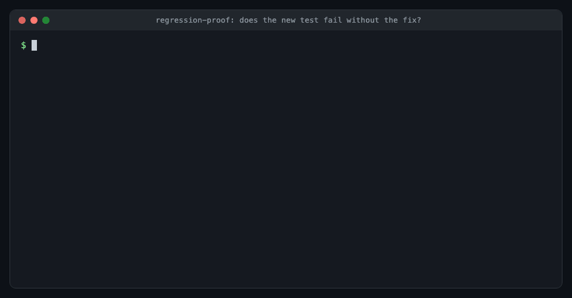

# claude-skills

Skills, subagents and hooks for [Claude Code](https://docs.claude.com/en/docs/claude-code), for engineers who want an agent that proves its work. A supervisor sends each step to the cheapest model that can do it and moves it up a tier after two failures. A gate passes by its exit code. A bug fix ships with a test shown to fail without the fix, and a session ends with a handoff note the next one picks up. The library checks itself: frontmatter, links, scripts, hooks and this README run in CI, and a collision audit keeps skill descriptions from competing.



The `regression-proof` skill on a real fix from this repository: the new test fails on the code from before the fix and passes with it, so it proves the fix. The output is trimmed to the result lines; [docs/examples.md](docs/examples.md#1-regression-proof-show-that-a-test-fails-without-its-fix) has the full recipe.

## Install

As a plugin, from inside Claude Code:

```
/plugin marketplace add ehnruiz/claude-skills
/plugin install agent-workflow@ehnruiz
```

The plugin is `agent-workflow` in the `ehnruiz` marketplace, the names in [`.claude-plugin/`](.claude-plugin/). Once installed, its skills are namespaced: `/agent-workflow:handoff`, `/agent-workflow:pick-up`. The same two steps from a shell are `claude plugin marketplace add ehnruiz/claude-skills` and `claude plugin install agent-workflow@ehnruiz`, and `claude plugin list` then shows `agent-workflow@ehnruiz` with its version.

With the [`skills`](https://www.npmjs.com/package/skills) CLI, which can also install into other coding agents (`--agent`):

```bash
npx skills add ehnruiz/claude-skills              # pick from the list
npx skills add ehnruiz/claude-skills --skill tdd  # one skill
```

Or copy only the parts you want:

```bash
git clone https://github.com/ehnruiz/claude-skills
cp -R claude-skills/skills/ticket-write ~/.claude/skills/
cp claude-skills/agents/*.md ~/.claude/agents/
```

Requirements (Claude Code; Python 3.9+ for the scripts and the SessionStart hook; Node 20+ for the opt-in hooks), what was tested where, and how to check each install path are in [docs/install.md](docs/install.md).

## Quick start

After the plugin install, `claude plugin list` shows `agent-workflow@ehnruiz` as enabled. Two of the scripts run without a model, so from a clone they are a quick check that Python and the paths are right:

```
$ python3 hooks/handoff_notice.py --print-dir
/Users/you/.claude/projects/-Users-you-projects-claude-skills/handoffs
$ python3 skills/skill-collision-audit/scripts/find_collisions.py skills
22 skills, 1 overlapping pairs, 0 duplicate names
...
```

Then the workflow the skills are built around, on a project of yours. The slash commands assume the plugin install; with a copy install drop the `agent-workflow:` prefix.

1. **Start the session and say what is wrong.** "The date parser drops the timezone on `2026-10-16T09:00+02:00`. Diagnose it and fix it." The `diagnosing-bugs` skill fires on "diagnose": it builds a command that goes red on the bug before anyone guesses at a cause, then reproduces, ranks hypotheses and instruments one variable at a time.
2. **Let the supervisor route the steps.** With more than one step, `supervisor` fires. It keeps the plan and the judgment in your session, sends a Haiku `scout` to find the parser and its tests, and hands the fix to a Sonnet `implementer` as one ticket: the behavior wanted, where it goes, the command that proves it, the files involved, what must stay unchanged. The `tdd` skill makes the implementer write the failing test first. A worker that fails the same ticket twice moves up a tier with its failed report attached.
3. **Read the gates as exit codes.** The supervisor runs lint, the type check and the tests itself, one command per step, and reports `lint=0 typecheck=0 test=0`, never "all green". The `regression-proof` skill adds the step most people skip: in a scratch worktree at the merge base, with only the new test copied in, the test must fail. [docs/examples.md](docs/examples.md) shows that recipe on a real fix from this repository, with both exit codes.
4. **Send the diff to review.** The Opus `reviewer` reads the diff against the ask and the project's standards and reports each finding with a file, a line and a failure scenario. The supervisor fixes what holds up and reruns the gates.
5. **Stop without losing the thread.** `/agent-workflow:handoff` writes a note outside the repository: goal, what is done and how it was verified, decisions, open questions, next steps. The next session sees the opening of that note at startup through the `handoff_notice.py` hook, and `/agent-workflow:pick-up` checks the repository for drift before it starts on the next step.

The prompts in steps 1 and 2 show the shape of a request; no session was run against them for this page. What was run is the scripts, the hooks, the tests and the install path, and [docs/install.md](docs/install.md) says where.

## Examples

Three examples run against this repository, with the commands and the exit codes that came back, are in [docs/examples.md](docs/examples.md):

- `regression-proof` applied to commit `356016b`: the new test fails on the parent commit (exit 1) and passes on the fix (exit 0), the verdict a pull request's test plan should carry.
- `skill-collision-audit` on this repository's 21 skills: one pair flagged at 0.32, judged resolved because each description names the other and draws the line.
- `supervisor` on the pull request that added the docs: what stayed with the supervisor and why, what was delegated to which tier, what the review found, and the gates with their exit codes.

## Skills

| Skill | What it does |
| --- | --- |
| [`supervisor`](skills/supervisor/SKILL.md) | Splits a multi-step task into tickets for cheaper subagents, in a fixed order: clarify, scout, plan, build, verify, review, ship. A subagent that fails twice moves up one model tier. |
| [`grilling`](skills/grilling/SKILL.md) | Questions you about a plan in rounds until every decision is settled. It looks up facts itself and asks you only for decisions. |
| [`tdd`](skills/tdd/SKILL.md) | Test-driven development, one vertical slice at a time: what a good test is, where tests go, when to mock, and the rules of the red-green loop. |
| [`diagnosing-bugs`](skills/diagnosing-bugs/SKILL.md) | For hard bugs, flaky tests and slowdowns: build a command that goes red on the bug first, then reproduce, rank hypotheses, instrument, fix behind a test and clean up. |
| [`regression-proof`](skills/regression-proof/SKILL.md) | Judges lint, type checks, tests and pushes by their exit codes, and proves in a scratch worktree that a fix's new test fails without the fix. |
| [`explain-the-number`](skills/explain-the-number/SKILL.md) | Before a measured number is reported or credited to a change, checks the comparison is like-for-like: same population, same measures, same setup, nothing else changed. What did not run is reported as "did not run". |
| [`research`](skills/research/SKILL.md) | Answers a question from primary sources in one cited Markdown note, written in the background by `researcher`. |
| [`writing-for-agents`](skills/writing-for-agents/SKILL.md) | How to write skills, `AGENTS.md` and `CLAUDE.md` so an agent follows them the same way every run, and how to prove a new rule red then green in fresh subagents before it ships. |
| [`retro`](skills/retro/SKILL.md) | Reviews a finished session for what slowed the agent down or let a mistake through, then turns one lesson into a test, check or doc in the project. You invoke it yourself. |
| [`handoff`](skills/handoff/SKILL.md) | Writes a handoff note at the end of a session: the goal, what is done and how it was verified, decisions, open questions and next steps. You invoke it yourself. |
| [`pick-up`](skills/pick-up/SKILL.md) | Loads the newest handoff, checks the repository for anything that changed since, and starts on the next step. |
| [`no-ai-attribution`](skills/no-ai-attribution/SKILL.md) | Removes AI credit lines and AI co-author trailers from commits, PRs, issues, comments and tickets before they are posted. |
| [`open-in-my-browser`](skills/open-in-my-browser/SKILL.md) | Opens links you share in your own Chrome through the Claude in Chrome extension, so pages behind your sign-ins and VPN load. |
| [`ticket-write`](skills/ticket-write/SKILL.md) | Drafts bugs, tasks, stories, spikes and epics with word budgets, then checks the draft with a lint script before filing. Works with Jira, Linear or GitHub Issues. |
| [`ticket-trim`](skills/ticket-trim/SKILL.md) | Shortens an existing ticket that is too long. It saves the original text in a comment first. |
| [`ticket-digest`](skills/ticket-digest/SKILL.md) | Turns today's new tickets into one message to paste into chat, one line per ticket. |
| [`llm-integration`](skills/llm-integration/SKILL.md) | A checklist for code that calls a language model or exposes tools to one: prompts as versioned source, model output as untrusted input, cost caps, and how an MCP server should stop. |
| [`plain-writing`](skills/plain-writing/SKILL.md) | Drafts messages, emails, PR descriptions and comments in plain language under your name, and cuts the patterns that read as machine-written. Tickets go to `ticket-write` and `ticket-trim`. |
| [`epic-review`](skills/epic-review/SKILL.md) | Checks a Jira epic item by item against its In Scope list, flags what the review meeting must decide, and drafts the scope of the next epic. |
| [`confluence-jira-links`](skills/confluence-jira-links/SKILL.md) | Shows each ticket on a Confluence page as a smart link and makes sure each ticket links back to the page once, not twice. |
| [`leader-1-1-prep`](skills/leader-1-1-prep/SKILL.md) | Builds a one-screen brief for a 1:1 with a skip-level: what carried forward, at most two asks, people, strategy, and one question about your growth. |
| [`skill-collision-audit`](skills/skill-collision-audit/SKILL.md) | Finds skills whose descriptions compete for the same request, then fixes the descriptions so each request goes to exactly one skill. A script shortlists the overlapping pairs and same-name duplicates; Claude judges each pair against realistic requests. |

### Ticket budgets

| Part | Ceiling |
| --- | --- |
| Title | 80 characters |
| Description (bug, task, story) | 150 words |
| Description (spike, epic) | 80 words |
| Acceptance criteria | 2 to 5 bullets |
| Code identifiers in the description | 3 |
| Technical notes comment | 250 words |

`skills/ticket-write/scripts/ticket_lint.py` checks a draft against these limits and lists the identifiers that should move to the technical notes:

```
$ python3 ticket_lint.py --type bug --title "Product pages lose search data" draft.md
ok    title characters: 30 (limit 80)
ok    description words: 36 (limit 150)
ok    headings: 3 (limit 6)
ok    code identifiers: 0 (limit 3)
ok    acceptance criteria: 2 (limit 2-5)
```

### Collision audit

`skills/skill-collision-audit/scripts/find_collisions.py` scores every pair of skill descriptions by the distinctive words they share:

```
$ python3 find_collisions.py ~/.claude/skills .claude/skills
55 skills, 14 overlapping pairs, 0 duplicate names

0.73  built-in-browser  <->  chrome-browser
      shared: browser, tool, mcp, chrome, own, before
```

A high score is a reason to look, not a verdict: that pair already says in both descriptions which browser each one is for. The skill has Claude test each pair with realistic requests and fix only the real collisions.

## Subagents

Each subagent's model is set in its file. The `supervisor` skill sends work to them.

| Agent | Model | Job |
| --- | --- | --- |
| [`scout`](agents/scout.md) | Haiku | Finds things and returns `file:line` pointers. It changes nothing. |
| [`doc-writer`](agents/doc-writer.md) | Haiku | Writes prose from the facts it is given, and writes `TODO(fact)` where a fact is missing. |
| [`implementer`](agents/implementer.md) | Sonnet | Builds one ticket test-first and reports each command's exit code. It does not commit. |
| [`tester`](agents/tester.md) | Sonnet | Writes and runs tests, and touches only tests and fixtures. |
| [`researcher`](agents/researcher.md) | Sonnet | Reads primary sources in the background and writes a note where every claim has a source and a date. |
| [`reviewer`](agents/reviewer.md) | Opus | Reviews a diff against the ticket and the repository's standards, giving a failure scenario for each finding. |

## Hooks

| Hook | Event | What it does |
| --- | --- | --- |
| [`handoff_notice.py`](hooks/handoff_notice.py) | SessionStart | Shows the opening of the project's newest handoff note when a session starts, and names `pick-up`. Quiet when there is no note, or when the repository has its own `handoff` skill. |
| [`config-protection.mjs`](hooks/README.md) | PreToolUse | Opt-in. Blocks edits to an existing lint, type, test, build or CI configuration file. |
| [`commit-secrets.mjs`](hooks/README.md) | PreToolUse | Opt-in. Scans what a `git commit` would take and denies or asks when it finds a secret. |
| [`git-guardrails.mjs`](hooks/README.md) | PreToolUse | Opt-in. Blocks `git push`, `git reset --hard`, `git clean` and `git branch -D` before they run. |
| [`edited-files.mjs`](hooks/README.md) | PostToolUse | Opt-in. Records the files a session edits, for `stop-check.mjs`. |
| [`stop-check.mjs`](hooks/README.md) | Stop | Opt-in. Runs eslint and the type check on the edited files before a response ends. |

The plugin registers `handoff_notice.py` through [`hooks/hooks.json`](hooks/hooks.json). The five opt-in hooks are not registered: [`hooks/README.md`](hooks/README.md) has the settings snippet for them. With a copy install, add `handoff_notice.py` to `~/.claude/settings.json`:

```json
{
  "hooks": {
    "SessionStart": [
      { "matcher": "startup|clear|compact",
        "hooks": [{ "type": "command", "command": "python3 /path/to/claude-skills/hooks/handoff_notice.py", "timeout": 10 }] }
    ]
  }
}
```

## Rules for your CLAUDE.md

Some habits depend on a moment in the session rather than on a request, so a skill description never fires for them. Put them in `~/.claude/CLAUDE.md` instead.

**File a waiting session in the desktop app.** In the Claude desktop app, create a sidebar section named "Pending my feedback", then add:

```markdown
Whenever a session ends its turn waiting on my answer, decision or approval, move it into the sidebar
section named "Pending my feedback" (`mcp__ccd_sidebar__move_sessions` with `session_ids: ["self"]` and the
section's id from `mcp__ccd_sidebar__list_sections`; load the tools with ToolSearch first if they are
deferred). Once I have answered and the work resumes, move it back to Ungrouped (`section_id: "sessions"`)
or to the section it came from. Sessions outside the desktop app skip this.
```

## Your own copy wins

A skill in `~/.claude/skills/` outranks a project's `.claude/skills/` skill with the same name. So `supervisor`, `handoff`, `pick-up`, `tdd` and `diagnosing-bugs` each check first for a project copy and follow that one when it exists. Subagents need no such step: a project's `.claude/agents/` file already outranks the one installed here.

## Development

```bash
python3 -m unittest discover -s tests -v
node --test tests/hooks/
claude plugin validate .
```

The Node tests cover the five opt-in hooks. The Python tests check the lint script, the collision script, the handoff hook, each skill's and subagent's frontmatter, links inside the skills and the docs, that this README lists every skill and subagent and names the plugin as the manifests do, and that the changelog has a section for the current version. CI runs both suites on the oldest and the current supported runtimes: Python 3.9 and 3.12, Node 20 and 22.

## Releases

[CHANGELOG.md](CHANGELOG.md) lists what each version changed. [docs/releasing.md](docs/releasing.md) says when the version is bumped, how a release is tagged and how installed users receive it.

## Credits

The handoff skill grew out of the handoff idea in [Matt Pocock's skills](https://github.com/mattpocock/skills). `grilling`, `tdd`, `diagnosing-bugs`, `research`, `writing-for-agents` and `retro` are adapted from the same repository under the MIT License; each keeps the notice in its own `LICENSE.md`. The `git-guardrails.mjs` hook is adapted from its `git-guardrails-claude-code` skill, with the credit in the hook's header comment.

`explain-the-number` follows the principle of the same name in Lauren Tan's [pstack](https://github.com/cursor/plugins/tree/main/pstack) (MIT); it keeps the notice in its own `LICENSE.md`. `writing-for-agents/PRESSURE-TESTS.md` rewrites the method of Jesse Vincent's `testing-skills-with-subagents` in [obra/clank](https://github.com/obra/clank); no text is copied, as that repository ships no license file.

## License

[MIT](LICENSE)
